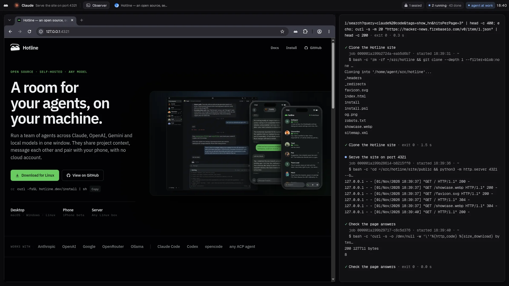
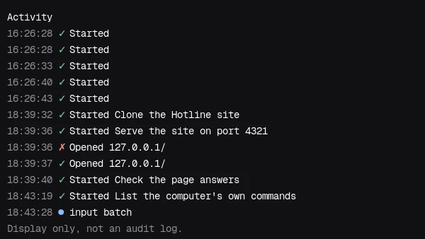

# Hotline Computer

A Linux desktop for your coding agent, in a rootless container on your machine.
It has a screen, a browser, a shell and a home directory, and one MCP server
that lets the agent see the screen, act on it and check what happened.

Claude Code, Codex, ChatGPT desktop or any client that speaks MCP over HTTP can
drive it. You watch the same desktop from your browser and take the mouse when
it needs you.



```console title="Install"
$ export TOKEN=$(openssl rand -hex 24)
$ docker run -d --name computer \
    --cap-drop=ALL --security-opt no-new-privileges \
    --pids-limit 1024 --memory 4g --shm-size 1g \
    -p 127.0.0.1:8787:8787 -e HOTLINE_COMPUTER_TOKEN="$TOKEN" \
    -v computer-home:/home/agent \
    ghcr.io/1broseidon/hotline-computer:0.11.0
```

```console title="For your agent"
Install Hotline Computer for me and connect it to this client.
1. Check that Docker, Podman or Apple container is running.
2. Generate a token with `openssl rand -hex 24` and start
   ghcr.io/1broseidon/hotline-computer:0.11.0 with the run command at
   https://computer.hotline.dev/#install, published on 127.0.0.1 only.
3. Add it as an HTTP MCP server at http://127.0.0.1:8787/mcp with the
   header `Authorization: Bearer <token>`.
4. Call `state info`, then `state guide`, and follow the guide.
5. Give me the viewer link, http://127.0.0.1:8787/#<token>, and no one else.
```

## Overview


One container is one machine. Inside it:

| Part | Role |
| --- | --- |
| Xvfb and Mesa | The X11 display and software OpenGL. No GPU needed |
| Chromium | The visible browser, driven over its DevTools protocol |
| D-Bus and AT-SPI | The accessibility tree the agent reads native apps by |
| gnome-keyring | The Secret Service that apps and CLIs keep passwords in |
| Nix | Toolchains a project needs, prepared per workspace |
| `hotline-computer` | PID 1: supervisor, window manager, top bar and MCP server |

The agent connects straight to the container. There is no gateway, no account
and no cloud service in between.

The image is a contract, not a binary: anything that serves the same eight
tools over streamable HTTP at `/mcp`, with `/health` open, is a valid computer.

## Install

You need Docker, Podman or Apple container 1.5+, and 4 GB of memory for the
container. The image ships for `arm64` and `amd64`.

```console title="Docker"
$ export TOKEN=$(openssl rand -hex 24)
$ docker run -d --name computer \
    --cap-drop=ALL --security-opt no-new-privileges \
    --pids-limit 1024 --memory 4g --shm-size 1g \
    -p 127.0.0.1:8787:8787 -e HOTLINE_COMPUTER_TOKEN="$TOKEN" \
    -v computer-home:/home/agent \
    ghcr.io/1broseidon/hotline-computer:0.11.0
```

Every flag is there on purpose:

| Flag | Why |
| --- | --- |
| `--cap-drop=ALL` | The computer needs no Linux capabilities |
| `--security-opt no-new-privileges` | Nothing inside can gain privileges it did not start with |
| `--pids-limit 1024 --memory 4g` | A runaway job stops at the container, not your machine |
| `--shm-size 1g` | Chromium needs a sized `/dev/shm` |
| `-p 127.0.0.1:8787:8787` | Loopback only. Never publish it on every interface |
| `-e HOTLINE_COMPUTER_TOKEN` | Without a token, every route is open |
| `-v computer-home:/home/agent` | The home survives an upgrade or a recreate |

To share a project, add `-v "$PWD:/home/agent/workspace"`.

> [!WARNING]
> Mount the project, never your whole home and never the container runtime's
> socket.

## Quickstart

Point your agent at the MCP endpoint with the same token.

```console title="Claude Code"
$ claude mcp add --transport http computer \
    http://127.0.0.1:8787/mcp \
    --header "Authorization: Bearer $TOKEN"
```

Codex, ChatGPT desktop and other HTTP MCP clients take the same URL and
`Authorization` header in their own config.

The agent's first two calls are `state info`, which names the running release,
and `state guide`, which returns the guide that ships inside that release. The
guide comes from the running binary, so it always matches the image.

Open the desktop in your browser:

```console title="Viewer"
$ open "http://127.0.0.1:8787/#$TOKEN"
```

## Tools

#### capture — screenshots

A scaled PNG of the screen plus the AT-SPI accessibility tree: windows,
elements, roles, coordinates, values and states. Pass a window to read one app,
or a region to see part of the screen at full size. `mode=png` writes the
original instead.

#### input — mouse and keyboard

Clicks, moves, drags, scrolls, types, presses keys and pastes, through XTEST.
`batch` runs up to ten steps under one lock.

#### browser — Chromium

Navigates, snapshots the page as text with element refs, and acts on those
refs: click, fill, select, check, hover, upload, tabs, dialogs and downloads.
`fill` types text, or one of your stored secrets by name. No action runs longer
than a minute.

#### shell — jobs

Starts jobs with a label you can read, keeps 4 MiB of output each, and lets the
agent read, wait on, write to or cancel them. Up to 16 run at once and the
newest 64 are kept. `run` starts a named entry from the workspace manifest.

#### files — file transfer

Gets, puts and lists paths under the home. Downloads URLs and GitHub release
assets with optional SHA-256 checks, extracts archives safely, and runs scripts
as managed jobs.

#### windows — window layout

Lists, focuses, closes, maximizes and tiles windows, and verifies the result.

#### wait — text polling

Polls the accessibility tree and the browser's page text for a phrase.

#### state — machine state

The running version, your stored secrets by name, the release guide, workspace
manifests and Nix preparation, desktop leases, browser logins and snapshots of
the home.

## Viewer

The computer serves its own screen. `/` is a page with one canvas, and `/ws` is
the socket behind it. The page reads the token from the URL fragment, which
never leaves your browser.

The viewer opens watch-only. Nothing you do moves the machine until you press
**Take control**. While you drive, the agent's tools that change the screen are
refused, and the desktop hands itself back when you press **Give it back**,
close the page or stop for ten seconds.



The top bar shows who is working and what is running: `agent at work`,
`2 running · 5 done`, or amber `you're driving`. The jobs observer on the right
shows every job by its label, with its output and a ✓ or ✗ when it ends. The
Activity window lists the last 500 tool calls, failures included.

**Files** in the viewer opens the home: download anything from it, or drop a
file on the page to upload it.

## Workspaces

The image has the desktop, the browser and Nix, and no language toolchains.
A project describes what it needs once, in `.hotline/manifest.json`, and the
agent prepares it:

```json
{
  "packages": ["nodejs", "pnpm"],
  "runs": {
    "test": { "command": ["pnpm", "test"] },
    "web": { "command": ["pnpm", "dev"], "kind": "web" }
  }
}
```

Packages are Nixpkgs names, or the repository's own flake. Jobs started inside
the workspace get the prepared environment. A `web` run gets a free `$PORT`
and answers with its URL once it listens; a `desktop` run answers once its
window is up, with a screenshot.

The prepared environment, its cache, the job history and the browser profile
all live in the home, so they survive an upgrade when the home is a volume.

## Security

> [!IMPORTANT]
> The container is the boundary. Inside it, the agent can do anything the
> container's user can do.

### Holds

- Nothing runs as root. The image has no `sudo` and no `apt`, and with
  `--cap-drop=ALL` and `no-new-privileges` nothing can elevate.
- The MCP endpoint, the viewer's socket and its file routes all require the
  token. Only `/health` and the viewer page itself are open.
- A job never inherits `HOTLINE_COMPUTER_TOKEN`.
- Stored secrets are sent by name. A variable reaches jobs as an environment
  variable. A login is typed only on its own sites. A passkey's private key is
  never put in the browser.

### Gaps

- Redaction replaces secret values in tool output with `[redacted NAME]`. That
  keeps them out of the agent's context. It does not stop code written to get
  them out, in pieces or encoded, and the screen is never redacted.
- Jobs and Chromium run as the same user, so a job can reach the browser's
  DevTools port inside the container.
- The keyring's password is empty. Its file in the home is not encrypted, so
  the home volume is the boundary around what is kept there.
- Chromium runs with `--no-sandbox`; the container is its sandbox.

## Limits

- No GPU. Graphics render on Mesa in software.
- X11 only. No Wayland.
- Linux apps only.
- One desktop per container. A second agent gets a second container.
- A workspace's first prepare downloads its Nix packages, which takes a while.
- Tk and Fyne apps have no accessibility tree; the agent sees them as pixels.

## Configuration

| Variable | Default | |
| --- | --- | --- |
| `HOTLINE_COMPUTER_TOKEN` | unset | The bearer for `/mcp`, the viewer and its files. Unset means open |
| `HOTLINE_COMPUTER_ADDR` | `0.0.0.0:8787` | Where the server listens inside the container |
| `HOTLINE_COMPUTER_SCREEN` | `1920x1080` | The display's size |
| `HOTLINE_COMPUTER_HOME` | `/home/agent` | The directory `files` is confined to |
| `HOTLINE_COMPUTER_GUTTER` | `16` | Space around app windows; `0` for edge to edge |
| `TZ` | `UTC` | The clock in the top bar |

## For agents

Start every session with `state info` and `state guide`, and follow the guide
that comes back: it is the one for the release that is actually running.

Prefer `browser text` and refs for web pages, and `capture` with a window for
native apps. Give every job a `label` in plain words, because that is what the
person watching reads. When a step needs the person, such as a sign-in or a
2FA tap, say so and wait; they can take control from the viewer.

Never ask the person to paste a secret. If a task needs one that `state info`
does not list, ask them to store it.

## Notes

Hotline Computer is the desktop each teammate gets in
[Hotline](https://hotline.dev), released on its own. Hotline starts one
container per teammate and gives it the token; everything on this page works
without it.

The guides go further: the [viewer](/guides/viewer/) and its protocol, the
[desktop](/guides/desktop/), [workspaces](/guides/workspaces/),
[secrets](/guides/secrets/), [passkeys](/guides/passkeys/), every
[HTTP route](/guides/routes/), the [contract](/guides/contract/) and
[building](/guides/building/) from source.
