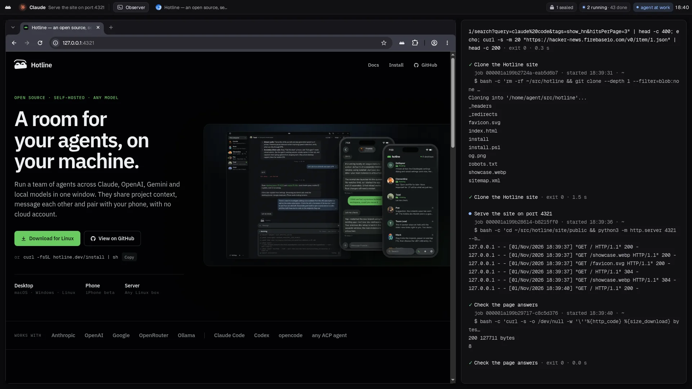

# Hotline Computer

**Your coding agent's own Linux desktop.** A rootless container on your
machine with a screen, a browser and a shell. Claude Code, Codex or any MCP
client drives it; you watch from your browser and take the mouse when it needs
you.



```sh
export TOKEN=$(openssl rand -hex 24)
docker run -d --name computer \
  --cap-drop=ALL --security-opt no-new-privileges \
  --pids-limit 1024 --memory 4g --shm-size 1g \
  -p 127.0.0.1:8787:8787 -e HOTLINE_COMPUTER_TOKEN="$TOKEN" \
  -v computer-home:/home/agent \
  ghcr.io/1broseidon/hotline-computer:0.11.0

claude mcp add --transport http computer http://127.0.0.1:8787/mcp \
  --header "Authorization: Bearer $TOKEN"

open "http://127.0.0.1:8787/#$TOKEN"   # watch it work
```

## Docs

The **[manual](https://computer.hotline.dev)** covers install, the eight
tools, workspaces, security and limits. The guides go deeper:

| Guide | Covers |
| --- | --- |
| [Viewer](https://computer.hotline.dev/guides/viewer/) | Watching, taking control, files, the socket protocol |
| [Desktop](https://computer.hotline.dev/guides/desktop/) | The top bar, the job observer, Activity, your own terminal |
| [Workspaces](https://computer.hotline.dev/guides/workspaces/) | Nix preparation, where environments live, software without root |
| [Secrets](https://computer.hotline.dev/guides/secrets/) | Variables, logins, the keyring, what redaction does and does not stop |
| [Passkeys](https://computer.hotline.dev/guides/passkeys/) | Making one with your approval, and where its key lives |
| [HTTP routes](https://computer.hotline.dev/guides/routes/) | Every route, which need the token, and the settings |
| [Contract](https://computer.hotline.dev/guides/contract/) | What makes a valid computer, what is in the image, boot |
| [Building](https://computer.hotline.dev/guides/building/) | `make` targets, release checks, the source layout |

The manual and the guides are `MANUAL.md` and `guides/` in this repository,
printed by [inkcap](https://inkcap.io).

## License

Licensed under either of the [Apache License, Version 2.0](LICENSE-APACHE)
or the [MIT license](LICENSE-MIT), at your option. Unless you explicitly
state otherwise, any contribution intentionally submitted for inclusion in
the work by you, as defined in the Apache-2.0 license, shall be dual
licensed as above, without any additional terms or conditions.
